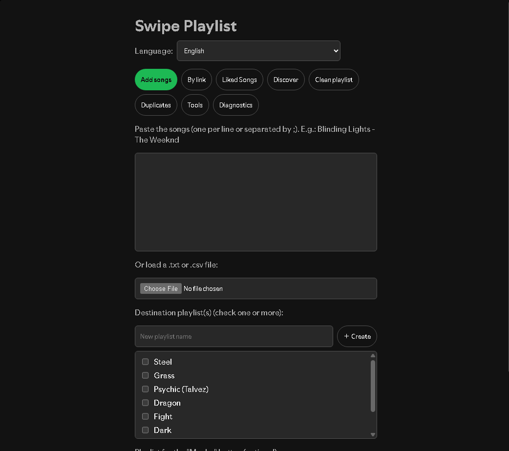
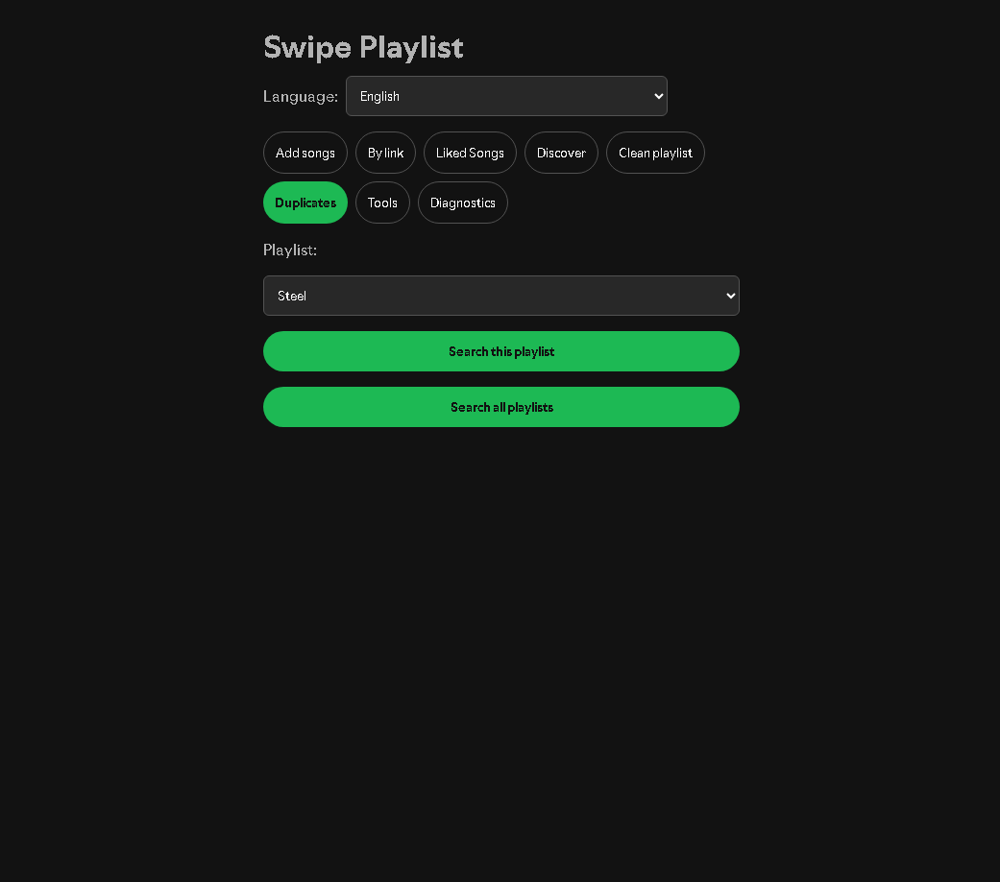
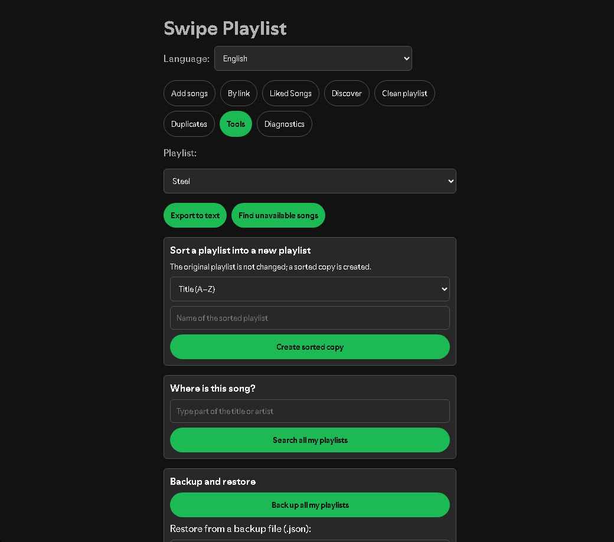

# Swipe Playlist for Spicetify

A [Spicetify](https://spicetify.app) custom app that lets you build and clean playlists **Tinder-style**: the song plays, and you press ✓ to add it or ✕ to skip it. No more adding songs one by one.

> English · [Português](#português-brasil)

<!-- Add screenshots here, e.g.:  -->

## Features

- **Add songs in bulk** from a pasted list (`Song - Artist`, one per line), a `.txt`/`.csv` file, a public playlist link or your Liked Songs.
- **Discover**: reads a playlist's name and description (bio), searches for songs that match, and lets you approve them one by one. You choose how many songs you want to see.
- **Swipe screen**: listen, then ✓ add / ✕ skip / ? "Maybe" (sends it to a playlist of your choice). Several destination playlists are supported, plus **Undo** and **save progress**.
- **Duplicate protection**: if a song is already in the playlist you get a warning and a confirmation before adding it again.
- **Clean playlist**: go through a playlist and ✓ keep, ✕ remove or ➜ move each song.
- **Duplicates finder**: scan one or all of your playlists, remove a single duplicate or all of them at once.
- **Create a new playlist** right from the app and use it as a destination (also in Discover).
- **Tools**: export a playlist to text (`Song - Artist`), find songs that are no longer available, **sort a playlist** into a new one (title, artist, album, date added or random), find **where a song is** across all your playlists, and **back up / restore** all your playlists to a `.json` file.
- **Queue button** (optional): send the current song to your playback queue instead of a playlist.
- **Follows your Spicetify theme**: colors come from the theme's variables.
- **Diagnostics tab**: shows which Spotify APIs work on your setup (useful for bug reports).
- **Languages**: English, Português (Brasil) and Español. Pick one in the app or leave it on **Automatic**, which follows Spotify's language and then the system's.

## Requirements

- The Spotify desktop app with [Spicetify](https://spicetify.app/docs/getting-started) installed and working.

## Install

1. Open Spicetify's custom apps folder:
   - **Windows:** `%appdata%\spicetify\CustomApps`
   - **Linux / macOS:** `~/.config/spicetify/CustomApps`
2. Put this repository there in a folder called `swipe-playlist`:
   ```bash
   cd <the CustomApps folder>
   git clone https://github.com/vnii-dev/spicetify-swipe-playlist swipe-playlist
   ```
   (Or download the ZIP and extract `index.js` and `manifest.json` into `CustomApps/swipe-playlist`.)
3. Enable it and apply:
   ```bash
   spicetify config custom_apps swipe-playlist
   spicetify apply
   ```
4. Fully close Spotify (also from the system tray) and open it again. **Swipe Playlist** appears in the sidebar.

### Update

```bash
cd <the CustomApps folder>/swipe-playlist
git pull
spicetify apply
```

## Quick guide

| Tab | What it does |
| --- | --- |
| **Add songs** | Paste a list or load a `.txt`/`.csv`, pick the destination playlist(s), start swiping. |
| **By link** | Swipe through the songs of a public playlist. |
| **Liked Songs** | Triage your liked songs into the right playlists. |
| **Discover** | Finds new songs from a playlist's name and description. |
| **Clean playlist** | Keep, remove or move the songs already in a playlist. |
| **Duplicates** | Find and remove duplicates in one or all playlists. |
| **Tools** | Export to text, find unavailable songs, sort into a new playlist, find where a song is, back up / restore. |
| **Diagnostics** | Tests the Spotify APIs and the write path. |






Sorting and restoring never touch your existing playlists: sorting creates a sorted copy, and restoring creates new playlists named `<name> (restored)`.

List format: one song per line, `Song - Artist`. Numbering (`1.`), bullets and the `–` dash are accepted; `various` as the artist is ignored.

## Languages

English is the base language. The language selector is at the top of the app; **Automatic** uses Spotify's language and falls back to the system's, then to English.

To add a language, edit `index.js`: add a block to the `I18N` object (the key is the English text, the value is your translation, keep the `{0}`, `{1}` placeholders) and list it in `LANGS`. Missing keys fall back to English. Pull requests are welcome.

## Troubleshooting

- **"429 … rate limit"**: Spotify's web API is temporarily limiting requests. The app spaces its calls and waits when asked to, but you may need to wait a few minutes. Reading and editing playlists uses Spotify's internal client API, so it keeps working.
- **My playlists don't load / something fails**: open the **Diagnostics** tab, run the diagnostics (and the write test), and include the output when you open an issue.
- **The search finds nothing**: the app uses the web API when available and Spotify's internal search otherwise. The Diagnostics tab shows which one works for you.

## How it works / notes

- Since February 2026 Spotify changed parts of its Web API (for example `/playlists/{id}/tracks` became `/items`), and in recent clients the `CosmosAsync` helper returns errors as plain objects instead of throwing. The app therefore reads and edits playlists through the client's internal APIs (`Spicetify.Platform`) first, and uses the web API only as a fallback.
- Those internal APIs are not documented and may change between Spotify versions. Every write is verified (the app checks that the song really appeared or disappeared) before it is trusted.
- Playlists of other people may not be readable, depending on Spotify's restrictions.

## Disclaimer

This project is not affiliated with, endorsed by or sponsored by Spotify. Spicetify modifies the Spotify client; use it at your own risk. Back up playlists you care about before bulk operations such as "remove all duplicates".

## License

[MIT](LICENSE)

---

# Português (Brasil)

**Swipe Playlist** é um app customizado do Spicetify para montar e limpar playlists no estilo "Tinder": a música toca e você aperta ✓ para adicionar ou ✕ para pular. Chega de adicionar uma por uma.

## O que faz

- Adiciona músicas em lote a partir de uma lista colada (`Música - Autor`, uma por linha), de um arquivo `.txt`/`.csv`, do link de uma playlist pública ou das suas Músicas Curtidas.
- **Descobrir**: lê o nome e a descrição (bio) da playlist e procura músicas parecidas. Você escolhe quantas quer ver e aprova uma por uma.
- Botão **Talvez**, várias playlists de destino, **Desfazer** e progresso salvo.
- Aviso e confirmação quando a música já está na playlist.
- Criar uma **playlist nova** como destino, direto no app.
- Em **Ferramentas**: ordenar uma playlist em uma cópia nova (título, artista, álbum, data ou aleatório), achar **onde está uma música** em todas as suas playlists e fazer **backup e restauração** das playlists em um arquivo `.json`.
- Botão **Fila** opcional e visual que segue as cores do seu tema do Spicetify.
- **Limpar playlist** (manter, remover ou mover), **Duplicadas** (remover uma ou todas), exportar playlist para texto e achar músicas indisponíveis.
- Idiomas: Português (Brasil), English e Español, com a opção **Automático** (usa o idioma do Spotify e depois o do sistema).

## Instalação

1. Abra a pasta de apps do Spicetify:
   - **Windows:** `%appdata%\spicetify\CustomApps`
   - **Linux / macOS:** `~/.config/spicetify/CustomApps`
2. Coloque o projeto lá, numa pasta chamada `swipe-playlist` (com `git clone` ou copiando `index.js` e `manifest.json`).
3. No terminal:
   ```bash
   spicetify config custom_apps swipe-playlist
   spicetify apply
   ```
4. Feche o Spotify por completo (inclusive na bandeja do sistema) e abra de novo.

Se algo falhar, abra a aba **Diagnóstico**, rode os testes e cole o resultado ao abrir uma issue.

## Aviso

Projeto sem ligação com o Spotify. O Spicetify modifica o cliente do Spotify; use por sua conta e risco e faça backup das playlists importantes antes de remover duplicadas em lote.
